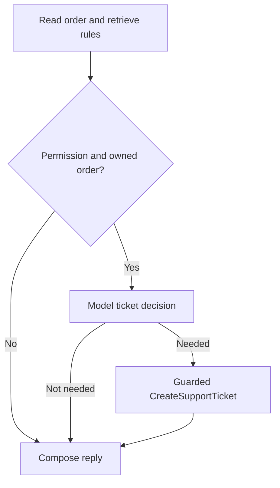

# ADR 0004: Separate ticket permission from ticket necessity

- Status: Accepted for this implementation change
- Date: 2026-10-08
- Scope: Support.API and the support page

## Context

The `baseline-always-create` tag preserves the previous behavior: for an owned
order, `AllowTicket=true` requests a ticket even when an explanation is enough.
The agent completes an omitted ticket action in C#, making the final action
similar to the predefined workflow.

To compare useful model decisions, permission and necessity must be separate.
Permission comes from the current buyer request; the model evaluates necessity.

## Decision

Interpret `AllowTicket` as permission to create a ticket if needed. A ticket is
appropriate when the buyer explicitly requests a new ticket or the issue needs
human action that policy explanations and order data cannot resolve. Questions
answered by those facts do not require a ticket. Insufficient context calls for
clarification. History neither grants permission nor requests another ticket by
merely mentioning an existing one.

The agent selects `CreateSupportTicket` through its normal tool loop. C# still
completes missing retrieval and selected-order reads, but never completes ticket
creation after the loop.

The workflow adds `decide_ticket` before its ticket branch. C# skips model
classification without permission or an available owned order. Eligible requests
use a schema-only `DecideSupportTicket` function call to return `needsTicket` and
a bounded reason code. This call does not execute a business tool.

C# rejects malformed, multiple, unknown or contradictory decisions before writing.
The real `CreateSupportTicket` still checks current permission, ownership and
idempotency. Those guards are unchanged.

When permission was given but no ticket was created, validation requires a fixed
customer-facing sentence in the demo language. A repair or fallback must preserve
that fact. A created ticket must retain its exact returned ID.

## Alternatives considered

- Always create when permitted: preserved as the baseline; it cannot avoid
  unnecessary tickets.
- Use keyword rules in C#: deterministic, but a poor substitute for the planned
  evaluation of contextual model decisions.
- Let the model choose whether permission exists: rejected; caller authority is
  enforced independently in C#.

## Consequences

Eligible workflows add one model call for classification. Agent and workflow
can now omit a permitted ticket, so missed and unnecessary tickets must both be
measured. Schema validation checks the decision's shape and consistency, not its
semantic correctness. Offline fakes verify routing and write guards; real-model
scenarios must establish decision quality.

Completed-request replay returns the stored snapshot, including replies from
the baseline. Use a new request ID to evaluate the changed policy.

## Implementation references

- [Policy and decision schema](../../src/Support.API/TicketPolicy.cs),
  [agent](../../src/Support.API/SupportAgent.cs),
  [workflow](../../src/Support.API/SupportWorkflow.cs).
- [Reply validation](../../src/Support.API/ReplyComposer.cs),
  [tool guards](../../src/Support.API/SupportTools.cs),
  [policy checks](../../tests/Support.SelfTests/TicketPolicyTests.cs).
- Authority remains governed by [ADR 0001](0001-model-proposes-code-decides.md).
