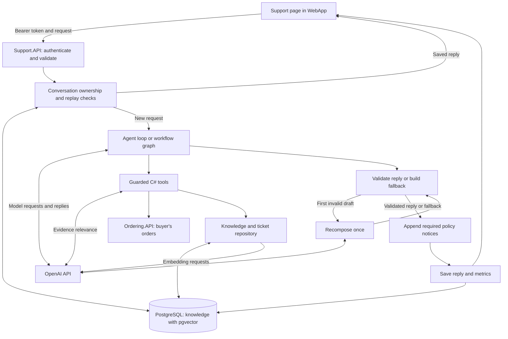

# AI support architecture

This document describes the current support implementation. Both modes share
authentication, conversation persistence, guarded tools and reply validation.
The diagram summarizes `POST /api/support/ask`; agent and workflow routing are
described in [ADR 0002](adr/0002-custom-agent-loop-and-framework-workflow.md).
Ticket necessity is described in
[ADR 0004](adr/0004-ticket-permission-and-necessity.md).

## Request path

The PostgreSQL box represents the `knowledge` database. Policy vectors, tickets
and conversation tables have different responsibilities within that database.
Model requests pass through `OpenAiApi`; the model does not call business services
or write to PostgreSQL directly. The agent can also recompose a reply after C#
adds required facts, even when its first draft passes validation.

## Responsibilities

| Component | Responsibility |
| --- | --- |
| [Support page](../src/WebApp/Components/Pages/Support.razor) and [SupportService](../src/WebApp/Services/SupportService.cs) | Collect the question, selected order, current permission and request IDs; display replies, sources, trace and metrics. WebApp forwards the buyer's bearer token. |
| [Program](../src/Support.API/Program.cs) | Authenticate the token, validate request fields, set the execution timeout and map errors to HTTP responses. |
| [Conversation service](../src/Support.API/ConversationMemory.cs) and [repository](../src/Support.API/ConversationRepository.cs) | Check ownership, serialize messages in a conversation, load history, detect replay and persist completed replies. |
| [SupportAgent](../src/Support.API/SupportAgent.cs) and [SupportWorkflow](../src/Support.API/SupportWorkflow.cs) | Execute model-selected tool calls or the predefined graph using the same request context. |
| [SupportTools](../src/Support.API/SupportTools.cs) | Allow only registered actions; enforce current permission, selected-order ownership and ticket-write constraints. |
| [KnowledgeRelevance](../src/Support.API/KnowledgeRelevance.cs) | Propose relevant candidate IDs through a model call; validate the selection and preserve original chunks. |
| [OrderingClient](../src/Support.API/OrderingClient.cs) and [KnowledgeRepository](../src/Support.API/KnowledgeRepository.cs) | Read buyer-filtered orders, retrieve policy chunks and persist demo tickets. |
| [OpenAiApi](../src/Support.API/OpenAiApi.cs), [ReplyComposer](../src/Support.API/ReplyComposer.cs) and [metrics collector](../src/Support.API/SupportMetricsCollector.cs) | Call the model and embedding endpoints, compose and validate replies, produce fallback text, and record timing and usage. |
| [ReplyNotices](../src/Support.API/ReplyNotices.cs) | Append application-owned mandatory wording using only policy sources selected during the current run. |

## Trust boundary

Questions, conversation text, retrieved documents and model output can influence
search and wording. They cannot grant permissions. C# obtains identity from the
validated JWT and checks order ownership through the buyer-filtered Ordering.API
list. The current request supplies the selected order and `AllowTicket`; neither
is accepted from model-generated tool arguments. `CreateSupportTicket` rechecks
permission and ownership before writing. The API key and bearer token are not
added to model messages or tool schemas. See
[ADR 0001](adr/0001-model-proposes-code-decides.md).

## Replay and persistence

A completed request is identified by `(conversationId, requestId)` and a hash of
its payload. Matching identifiers and payload return the saved reply without
model or tool execution. A changed payload returns HTTP 409; an inaccessible
conversation returns HTTP 404. Matching question text alone is not a replay.

Ticket writes independently enforce `UNIQUE(user_id, order_id, request_id)`.
This protects a retried write if processing stopped before a reply was saved.
Conversation processing holds a row lock until its database transaction ends.
Saved replies are snapshots; graph checkpoints and arbitrary-node resumption are
not implemented.

## Current behavior and limits

- `AllowTicket=true` permits a ticket for an owned order if needed. The agent
  selects the creation tool; the workflow adds a model decision before its ticket
  branch. C# completes missing retrieval and order reads, but not ticket writes.
  Ineligible workflows skip ticket classification. Invalid decisions fail before
  a write. Permitted requests without a new ticket must report that outcome.
- RAG searches eight demo documents using cosine distance and 1536-dimensional
  embeddings. Each query retrieves up to three chunks with score >= 0.30.
  A compound search keeps the complete query and at most two separate questions,
  then merges duplicate chunks. When history resolution or an agent shortens the
  search query, the separate questions come from the original current request.
  The resolved query remains first; a rewrite cannot remove those question parts.
  The plan still has at most three searches. One relevance-selection call per non-empty search
  tool result evaluates the merged candidates against the current question and
  bounded history. Similarity is candidate ranking, not proof of relevance.
- The selector may return only exact candidate IDs. Invalid decisions fail with
  an upstream error; they are not treated as an empty, successful selection.
  The Responses request explicitly forces `SelectKnowledgeSources`, and its
  strict argument schema enumerates only the current candidate IDs. History-only
  citations are not admitted to that schema. The workflow ticket classification
  likewise forces `DecideSupportTicket`; ordinary agent tool selection stays
  automatic. `requiredFunction` expresses this intent in `IResponsesModel`.
  These settings follow the [official function-calling contract](https://developers.openai.com/api/docs/guides/function-calling).
  C# still validates completed output, one call, the function name, arguments,
  unknown IDs and duplicates. Safe rejection codes such as `function_count` or
  `unknown_source_id` appear in the error and logs without echoing model output.
  There is no automatic retry or conversion of malformed decisions into empty evidence.
  Selected chunks retain their original text and scores. This model-based decision
  can still be wrong, so source relevance needs real-model and semantic evaluation.
- With no relevant evidence, C# composes a normal reply from confirmed order and
  ticket facts plus a statement that the retrieved material is insufficient.
  This branch uses no text-generation call, no unrelated citations, and
  `UsedFallback=false`. It does not infer service availability or corpus contents.
  A completed empty search is recorded so the agent does not repeat it merely
  because no source was selected. Permission, ownership and ticket necessity
  remain separate guarded decisions.
- Validation checks source IDs and confirmed ticket numbers. Invalid drafts get
  one repair attempt, then a deterministic fallback. Valid citations do not
  establish semantic correctness.
- `ReplyComposer.Finish` appends a mandatory authority-limit notice when a chunk
  from the `support-warranty` document is among the current selected sources.
  The notice states that the assistant cannot confirm a defect or approve a
  replacement or refund; support makes the decision. C# owns this wording and
  cites an actual selected chunk. A candidate rejected by relevance selection,
  a similar document name or a source present only in history does not enable it.
  The rule applies to both modes and fallback without another model call.
  Trailing literal copies of the fixed notice, including an uncited copy from
  the model, are normalized into one canonical block with a selected citation.
  Whitespace wrapping is allowed. Quoted occurrences and unavailable citations
  remain visible; this normalization does not detect semantic paraphrases.
  `reply notice warranty_authority` records assembly in the trace; this is not
  draft recomposition. Stored replays retain their original answer.
  This rule guarantees the notice's presence, not the completeness or consistency
  of the generated explanation. Semantic evaluation still checks the whole answer.
- [Structured behavior](model-behavior.md) snapshots application completion and
  reply recomposition. Replay retains these original-generation observations;
  older replies without the object keep unknown data.
- Preparation timing includes history loading and processing, but stops before
  reply persistence. Missing usage remains unknown; replay reports its own metrics.
- The [255 offline checks](../tests/Support.SelfTests/Program.cs) use fake
  dependencies. Real-model quality and PostgreSQL integration need separate checks.
- Model integration remains provider-specific; see
  [ADR 0003](adr/0003-direct-responses-api.md).
